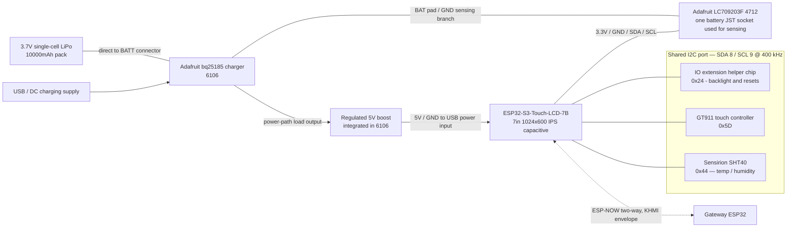

# Kelvin HMI — Wiring Diagram

Waveshare ESP32-S3-Touch-LCD-7B wall panel. Part of the [Kelvin Project Wiring Diagram.md](Kelvin%20Project%20Wiring%20Diagram.md) set.

---

## Wiring

- Display and touch controller are integrated on the Waveshare board; no external display wiring is needed.
- Leave the Waveshare battery socket disconnected. Connect the battery directly to the external charger;
  its BAT/GND pads feed the fuel gauge as a separate sensing branch, not the panel's load path.
- The **SHT40 connects to the board's I2C port**, sharing the single bus with the IO extension chip and the GT911 touch controller.

## I2C bus

| Device                   | Address | Role                              |
| :----------------------- | :------ | :-------------------------------- |
| IO extension helper chip | 0x24    | Backlight, touch/LCD reset, SD CS |
| GT911                    | 0x5D    | Capacitive touch controller       |
| Sensirion SHT40          | 0x44    | Temperature / humidity            |
| Adafruit LC709203F       | 0x0B    | External battery fuel gauge       |

All four share GPIO8 SDA / GPIO9 SCL at 400kHz. `Hmi.ino` initializes `Wire` once; display/touch and
fuel-gauge code reuse it. Display rendering uses the ESP-IDF RGB driver directly, not ESP32_Display_Panel.

| LC709203F connection | HMI connection                                                               |
| :------------------- | :--------------------------------------------------------------------------- |
| VIN / STEMMA red     | Regulated 3.3V rail; verify the board connection point against its schematic |
| GND / STEMMA black   | GND                                                                          |
| SDA / STEMMA blue    | GPIO8 SDA, shared with SHT40                                                 |
| SCL / STEMMA yellow  | GPIO9 SCL, shared with SHT40                                                 |
| INT                  | Not connected                                                                |
| THERM                | Not connected; firmware supplies a configured assumed temperature            |

Power gauge VIN from **3.3V**, not USB 5V, so its I2C pull-ups are safe for ESP32 GPIOs. All grounds must
be common. Do not connect the gauge's battery JST sockets to 5V or to the charger load output.

## Power

1. Connect the single-cell 3.7V LiPo directly to the 6106 charger's BATT connector. Check polarity against
   the PCB markings; a matching connector alone does not guarantee matching polarity.
2. Connect the charger's **BAT pad** to the positive contact of either LC709203F battery JST-PH socket,
   and charger **GND** to that socket's negative contact. Leave the gauge's other battery socket unused.
   BAT is the actual battery node, not the boosted 5V output or the power-path load output. This parallel
   sensing branch keeps panel load current out of the gauge's JST connectors and PCB traces.
3. Use the integrated 5V boost output on the [Adafruit bq25185 charger 6106](https://www.adafruit.com/product/6106):
   the terminal block's positive output is 5V and its negative output is GND.
4. Connect regulated 5V/GND from the boost to the panel's USB power input via a suitable USB power
   adapter/cable. The charger's USB-C connector is a charging **input**, not the panel supply output.
5. Connect the charging supply to the charger's input. Do not connect the pack to the Waveshare battery
   socket as well, and do not connect a second competing USB power supply to the panel.

Select the boost converter and wiring for the panel's load and startup surge. The 6106 is specified up
to 1A output, but Adafruit warns its TPS61023 can stall when starting into loads over 200mA; verify actual
cold startup and touch wake with the panel. The boost must stay enabled during ESP32 light sleep to
keep touch wake functional. The bq25185 charger has an unmodifiable six-hour charge safety timeout;
a depleted 10000mAh pack takes more than ten hours at 1A, before charge taper and panel consumption.
Account for that limitation in the charging arrangement rather than assuming one cycle fully charges it.

Battery percentage comes from the [LC709203F](https://www.adafruit.com/product/4712), not the Waveshare
helper ADC. Firmware reports unknown (`-1`) on failed/invalid reads and retries on subsequent polls.
`BATTERY_PACK_APA` in `Config.h` defaults to `0x36` (Adafruit's largest, 3000mAh preset); validate and
calibrate it for the 10000mAh pack. It is not a capacity-in-mAh field. `BATTERY_TEMPERATURE_C` defaults
to an assumed 25 C because THERM is unused. This is not temperature-based battery safety protection.

There is no charger-status connection in this wiring. Firmware estimates the charging bolt from the
fuel-gauge percentage: a rise sets `externalPower` true, a fall clears it, and equal readings retain
the last state. Comparisons use the gauge's 0.1% resolution before display rounding. The first valid
reading after boot establishes a baseline without a bolt; failed reads leave the tracked state and
baseline unchanged. Light sleep preserves this history. The bolt can remain on at a flat 100% until
a decline is observed, and small fluctuations can toggle it. It is an estimate, not proof of external
power or active charging. The charger's own LEDs still indicate charging/fault state.

## Telemetry

Polls every 60 seconds, including timer wakes with the screen dark; sends temperature, humidity and
fuel-gauge battery percentage on change or heartbeat. `HEARTBEAT_INTERVAL_S` is configured for 300 seconds;
the shared counter currently produces about six minutes between unchanged readings. No CO2 sensor:
the panel reports 0 for that field.

Two-way: sends mode, fan, setpoint, schedule, and forecast-lockout changes upstream; receives thermostat configuration, HVAC call state, and system-wide average readings back.

After a minute without touch, the ESP32 sleeps with the backlight off; touch on GT911 interrupt GPIO4
restores the display and requests thermostat state, control state and preferences again.

## Verification and references

- Run `Hmi.bat` to install `Adafruit LC709203F` and its BusIO dependency, then compile/upload as described
  in the [HMI README](../src/Kelvin.Devices/Hmi/README.md).
- Verify an I2C scan finds `0x0B` and that the displayed percentage agrees with the gauge across a real
  charge/discharge cycle. Disconnect the gauge's I2C connection to check that the UI shows unknown rather
  than 0%; reconnect it and wait for the next battery poll to confirm recovery.
- [LC709203F wiring and pinouts](https://learn.adafruit.com/adafruit-lc709203f-lipo-lipoly-battery-monitor/pinouts)
- [LC709203F Arduino library and pack presets](https://learn.adafruit.com/adafruit-lc709203f-lipo-lipoly-battery-monitor/arduino-use)
- [bq25185 5V boost pinouts, startup limitation and charging timeout](https://learn.adafruit.com/adafruit-bq25185-usb-dc-solar-charger-with-5v-boost-board/pinouts)
