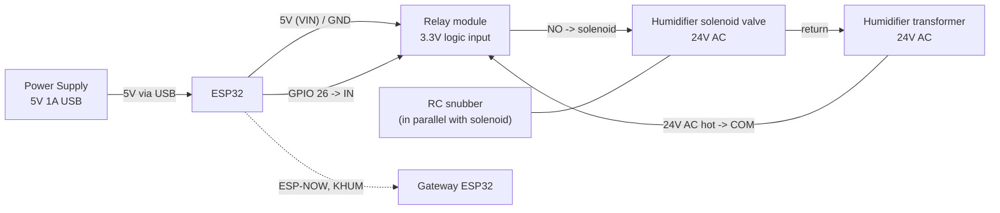

# Kelvin Humidifier — Wiring Diagram

ESP32 humidifier controller, powered over USB power supply. Part of the [Kelvin Project Wiring Diagram.md](Kelvin%20Project%20Wiring%20Diagram.md) set. Firmware and protocol details are in the [Humidifier README](../src/Kelvin.Devices/Humidifier/README.md).

---

## How it works

The ESP32 is always powered. It checks in with the Gateway at boot and every 5 minutes over ESP-NOW (`KHUM` frames), and the server pushes whether the humidifier should run, resending every 30 seconds while it should. The ESP32 acknowledges each push and drives a relay that switches the humidifier transformer's 24V AC to the solenoid valve.

The relay is released when:

- the server says the humidifier should be off, or
- no state has arrived from the server for 2 minutes (firmware fail-safe).

The humidifier transformer is only energized while the furnace is heating, so the solenoid can't open outside a heating cycle even if the relay is still closed.

## Wiring

## Pin map

| Signal      | Pin                                  |
| :---------- | :----------------------------------- |
| Relay IN    | GPIO 26 (`RELAY_PIN` in `Config.h`)  |
| Relay VCC   | 5V from the ESP32's VIN/5V pin (USB) |
| Relay GND   | Common ground with the ESP32         |
| ESP32 power | USB, 5V phone charger                |

`RELAY_ACTIVE_HIGH` in `Config.h` must match the relay module. The firmware writes the off level before enabling the pin so the solenoid isn't pulsed at boot.

## Power

A USB power supply powers the ESP32, and the relay module's 5V comes from the board's VIN/5V pin. Use a charger rated for at least 1A: WiFi transmit peaks plus the relay coil switching on one weak supply can brown out the ESP32, which releases the relay until the next state push.

The humidifier transformer only feeds the solenoid through the relay contacts. Its no-load voltage can read well above its 24V AC label (about 30V AC is typical, roughly 42V peak), so rate the relay contacts and the snubber for that.

## Solenoid switching

- Switch the solenoid's 24V AC through the relay's **COM / NO** contacts so a released relay (or an unpowered ESP32) leaves the valve closed.
- An **RC snubber is required in parallel with the solenoid**. The solenoid is inductive; the snubber absorbs the voltage spike when the relay opens, protecting the relay contacts and reducing interference that can reset the ESP32 or corrupt ESP-NOW traffic. Use a capacitor rated well above 24V AC (an X2-rated part is a common choice).
