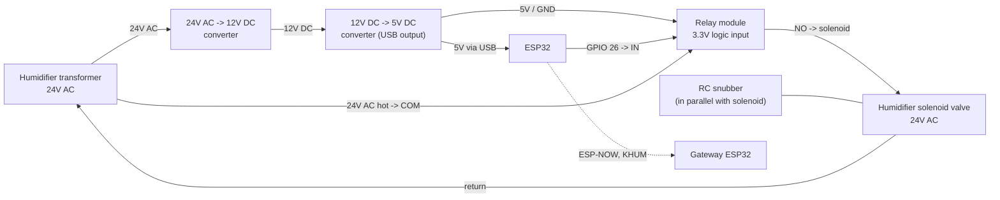

# Kelvin Humidifier — Wiring Diagram

ESP32 humidifier controller, powered from the humidifier's own 24V AC transformer. Part of the [Kelvin Project Wiring Diagram.md](Kelvin%20Project%20Wiring%20Diagram.md) set. Firmware and protocol details are in the [Humidifier README](../src/Kelvin.Devices/Humidifier/README.md).

---

## How it works

The humidifier transformer is only energized while the furnace is heating, so the ESP32 is only powered during a heating cycle. Once booted it pings the Gateway every 15 seconds over ESP-NOW (`KHUM` frames) and the server answers whether the humidifier should run. The ESP32 then drives a relay that switches 24V AC to the humidifier solenoid valve.

The relay is released when:

- the server answers that the humidifier should be off,
- the server hasn't answered for 2 minutes (firmware fail-safe), or
- heating stops and the transformer (and therefore the ESP32) loses power.

## Wiring

## Pin map

| Signal      | Pin                                  |
| :---------- | :----------------------------------- |
| Relay IN    | GPIO 26 (`RELAY_PIN` in `Config.h`)  |
| Relay VCC   | 5V from the 12V -> 5V converter      |
| Relay GND   | Common ground with the ESP32         |
| ESP32 power | USB, 5V from the 12V -> 5V converter |

`RELAY_ACTIVE_HIGH` in `Config.h` must match the relay module. The firmware writes the off level before enabling the pin so the solenoid isn't pulsed at boot.

## Power

1. **24V AC -> 12V DC**: a rectifying converter fed from the humidifier transformer's 24V AC.
2. **12V DC -> 5V DC**: a buck converter with a USB output, powering the ESP32 through its USB port and the relay module's 5V supply.

Size the converters for the ESP32 (WiFi transmit peaks) plus the relay coil, and check the transformer's VA rating still covers the solenoid with the extra load.

## Solenoid switching

- Switch the solenoid's 24V AC through the relay's **COM / NO** contacts so a released relay (or an unpowered ESP32) leaves the valve closed.
- An **RC snubber is required in parallel with the solenoid**. The solenoid is inductive; the snubber absorbs the voltage spike when the relay opens, protecting the relay contacts and reducing interference that can reset the ESP32 or corrupt ESP-NOW traffic. Use a capacitor rated well above 24V AC (an X2-rated part is a common choice).
