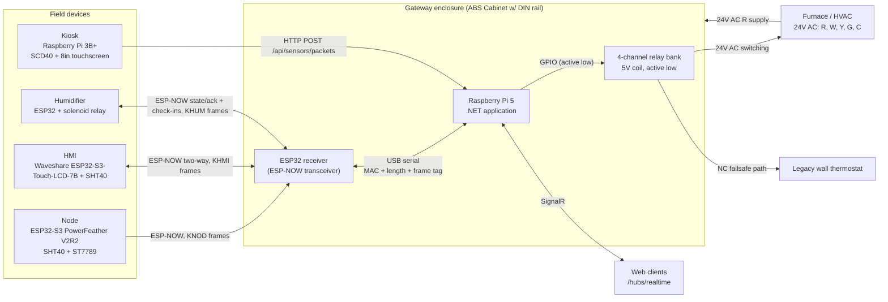
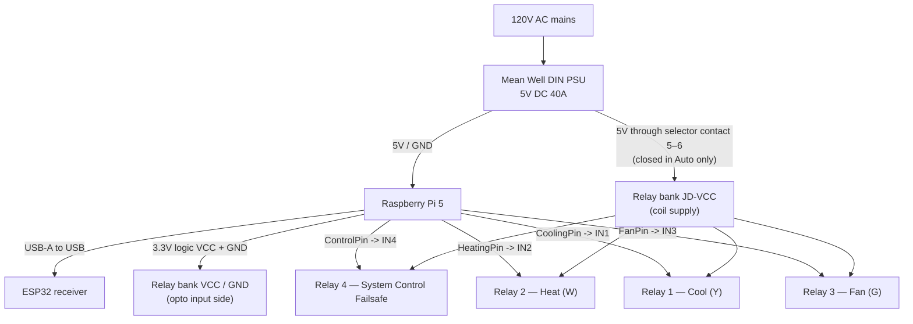
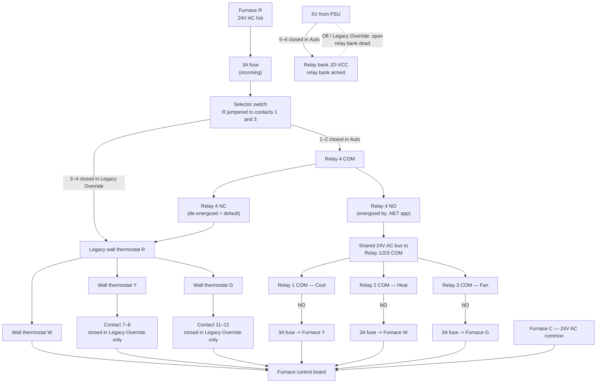
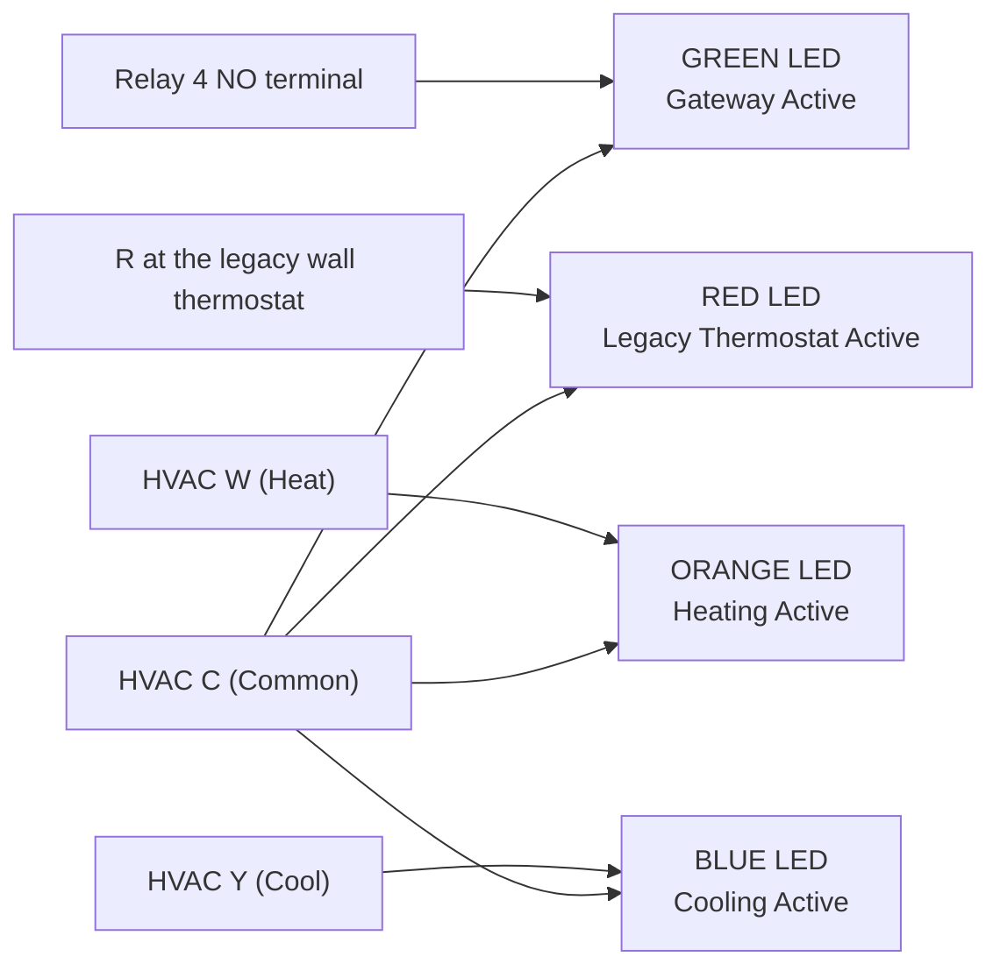
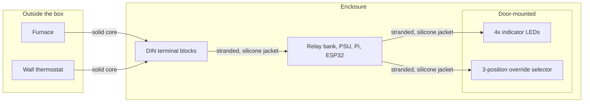
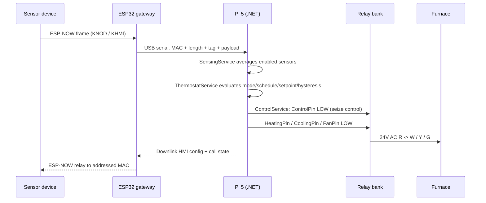

# Project Kelvin — Wiring Diagrams

This file covers system topology and the gateway enclosure.

Per-device diagrams lives in:

- [Kelvin Node Diagram.md](Kelvin%20Node%20%20Diagram.md) — ESP32-S3 PowerFeather V2R2, ST7789 SPI display, SHT40
- [Kelvin HMI Wiring Diagram.md](Kelvin%20HMI%20Diagram.md) — Waveshare ESP32-S3-Touch-LCD-7B, SHT40, LC709203F fuel gauge and external charger/5V boost
- [Kelvin Kiosk Wiring Diagram.md](Kelvin%20Kiosk%20Diagram.md) — Raspberry Pi 3B+, SCD40
- [Kelvin Humidifier Wiring Diagram.md](Kelvin%20Humidifier%20Diagram.md) — ESP32 and solenoid relay, powered over USB

Notes:

- These aren't proper wiring diagrams, but the circuity is simple enough that it should suffice.
- These diagrams, and the diagrams referenced above, were generated by AI based on descriptions of how they were built.

---

## 1. System topology

Kiosks deliberately bypass the ESP32 gateway and talks straight to the server over HTTP.

---

## 2. Gateway enclosure — DC power and logic

**Notes**

- The relay board is **active low**: the server drives a pin **LOW** to energize a relay, **HIGH** to release it (`RelayController`).
- GPIO assignments are not hard-coded. `HeatingPin`, `CoolingPin`, `FanPin`, and `ControlPin` live in the `Gateway` record in the database and are applied at runtime, so record the actual BCM numbers used on the build.
- Remove the **VCC–JD-VCC jumper** on the relay board so the opto-isolator input side is powered from the Pi while the coil side is powered from the PSU through the selector switch. This is what lets the Off and Legacy Override positions fully disable the relays.
- The Pi's GND and the PSU GND must be common for the GPIO signals to be referenced correctly.

---

## 3. Gateway enclosure — 24V AC HVAC control path

This is the tiered control system: a manual selector switch **in series with** the software-controlled Relay 4.

The switch is a 3-position (ON-OFF-ON) selector with **eight isolated SPST contacts**: terminal pairs 1–2, 5–6, 9–10 and 13–14 close in one outer position, 3–4, 7–8, 11–12 and 15–16 close in the other, and every contact is open in the centre. It is not a 4PDT; there is no shared common, so the incoming R is jumpered to one contact on each side. Which outer position is Auto and which is Legacy Override is a wiring choice; the assignment below is the one assumed in this document.

| Contact            | Closed in       | Function                              |
| :----------------- | :-------------- | :------------------------------------ |
| 1–2                | Auto            | Fused furnace R → Relay 4 COM         |
| 5–6                | Auto            | 5V from PSU → relay bank JD-VCC       |
| 3–4                | Legacy Override | Fused furnace R → legacy thermostat R |
| 7–8                | Legacy Override | Legacy thermostat Y → furnace Y       |
| 11–12              | Legacy Override | Legacy thermostat G → furnace G       |
| 9–10, 13–14, 15–16 | —               | Spare                                 |

Kelvin's fused W / Y / G outputs land directly on the furnace terminals and do not pass through the switch; only the legacy thermostat's Y and G do.

**Failsafe behavior**

| Condition                                        | Result                                                                                                                                                                                                                                                                                                 |
| :----------------------------------------------- | :----------------------------------------------------------------------------------------------------------------------------------------------------------------------------------------------------------------------------------------------------------------------------------------------------- |
| Switch in **Legacy Override**                    | 24V AC routed straight to the wall thermostat and its Y / G outputs reconnected; JD-VCC cut, relay bank completely dead.                                                                                                                                                                               |
| Switch in **Off** (centre)                       | No R reaches either controller and JD-VCC is cut, so nothing can call for heat, cooling or fan. A service position only; the furnace will not heat while the switch is left here.                                                                                                                      |
| Switch in **Auto**, Relay 4 de-energized         | Kelvin's HVAC control disabled. Relay 4 NC hands 24V AC to the wall thermostat, which can still call for **heat** (W). Its Y / G stay disconnected, so there is no cooling or fan until the switch is moved to Legacy Override. This is the state after a Pi crash, unrecoverable error, or power loss. |
| Switch in **Auto**, Relay 4 energized (GPIO LOW) | Kelvin's HVAC control enabled. Relay 4 NO feeds the COM of Heat/Cool/Fan.                                                                                                                                                                                                                              |

Relays 1–3 can only pass current when both the switch is in Auto **and** Relay 4 is energized, so there is no path for software to call for operation while the user has chosen manual override.

**Why the legacy Y and G are switched**

Relay 4 only interrupts the legacy thermostat's **R**; its W / Y / G outputs would otherwise stay wired to the furnace in parallel with the Relay 1/2/3 NO contacts, so any connection inside the legacy thermostat becomes a path between Kelvin's outputs. Mechanical and many older electronic thermostats hard-link **G→Y** when set to Gas or Oil so a cooling call runs the blower. With that link in place, energizing Relay 3 (Fan) put 24V AC on Y through the legacy thermostat and started the compressor without `ControlService` ever calling for cooling, so none of the minimum on/off or mode-switch guards applied, and the red LED stayed off because R was never involved. Opening Y and G outside the Legacy Override position breaks that path in both directions. W is left connected so the legacy thermostat can still heat in the software failsafe state; a heat-only backfeed would require a W-to-something link inside the thermostat, which none of the common fan-switch arrangements have. Meter any replacement thermostat for W↔Y and W↔G continuity in every mode before connecting it.

---

## 4. Indicator lights (24V AC)

| LED    | Tap point                                                     | Lit when                                                             |
| :----- | :------------------------------------------------------------ | :------------------------------------------------------------------- |
| Green  | Relay 4 **NO** terminal, referenced to C                      | Switch in Auto **and** Kelvin's HVAC control is enabled              |
| Red    | R wire where it enters the legacy thermostat, referenced to C | Switch in Legacy Override, or in Auto with Kelvin's control disabled |
| Orange | Parallel across W output to furnace and C                     | Relay 2 bridges R→W or the wall thermostat calls for heat.           |
| Blue   | Parallel across Y output to furnace and C                     | Relay 1 bridges R→Y or the wall thermostat calls for cooling.        |

Green and Red are never lit together; both are dark with the switch in Off, since no R reaches either controller.

---

## 5. Enclosure conductor and connector rules

- **Solid core**, exclusively, for furnace entry lines and wall-thermostat exit lines, landed directly on dedicated DIN terminals.
- **Stranded copper with silicone insulation** for all internal routing, for flex life and to avoid metal fatigue.
- 3A fuses on the incoming 24V AC line and on each outgoing 24V AC line back to the furnace.

---

## 6. Signal flow summary

